# Sputnik Handwired Split Corne – ZMK config

ZMK firmware configuration for a handwired 42-key split Corne (nice!nano, BLE).
The keymap lives in [`config/corne_hw.keymap`](config/corne_hw.keymap).

## Building and flashing

Every push to GitHub triggers the [build workflow](.github/workflows/build.yml).
Download the firmware artifacts from the Actions run and flash both halves
(`corne_hw_left`, `corne_hw_right`). `settings_reset` clears pairing/settings if needed.

The keymap is only changed through this repository: no ZMK Studio edits.

## Layout ground rules

- **The OS layout is French AZERTY.** The keymap sends QWERTY keycodes, so the
  bindings read differently from what is typed (`&kp Q` types `a`, `&kp N4` types `'`,
  `&kp RA(N0)` types `@`, …). The drawing below shows what is *typed*.
- **Home row modifiers**: GUI / Alt / Ctrl / Shift on `q s d f` and `j k l m`.
  The firmware enforces the same-hand rule for them: a home-row key only
  becomes a modifier when the next key is on the other hand or a thumb, or
  when held past 280 ms. To repeat a home-row letter (e.g. `j` in vim), tap
  it, then hold it.
- **Everything lives on the keyboard**, so it works plug and play on any
  machine with an AZERTY layout: no OS or app configuration is needed.
  A shortcut the keyboard can't produce on its own is tracked in the
  backlog, until there are enough of them to choose one strategy for all.
- **Never press two keys at the same time with the same hand.** Layers are held
  with a thumb, and their keys sit on the opposite hand. Accepted exceptions:
  - Bluetooth management on the low layer.
  - Modifier + arrow on the nav layer (selection, word jumps).
- **Accented letters come from combos** on the base layer: press both keys
  together. The drawing shows each combo as a small key between its two
  keys (à, è, é, ç, ù, and `^`, the dead key for ê, î, ô).

## Layers

The drawing is generated from the keymap: GitHub Actions
redraws it after every keymap change, and `pixi run draw` does the same
locally. Never edit it by hand. To print it: each run of the "Draw
keymap" workflow on GitHub has `cheatsheet.pdf` (two A4 pages) to download, and
`pixi run cheatsheet` writes the same file to `keymap-drawer/` (not
committed). Each key shows what the AZERTY OS types;
a small legend below is the modifier or layer when held, and a red key is
the thumb that opens that layer.

Layers are held with a thumb, their keys on the other hand (Mods is
tapped instead):

- **Low** (left thumb): Bluetooth on the left; a numpad on the right. The
  digits are keypad keys: NumLock must be on (`NumLk` toggles it). `*` is
  the keypad `*` and works regardless of NumLock.
- **Raise** (right thumb): every symbol, on both hands, from Arsenik
  (see below). Held, only its left half follows the same-hand rule;
  Raise's own tap reaches the whole layer. Low keeps its symbols for
  now (2026-10-18, to review around 2026-11-08).
- **Mods** (right outer thumb, AltGr, tapped alone): one-shot modifiers
  where the home-row mods are. See below.
- **Nav** (left outer thumb, which has no tap since 2026-10-19: Super is
  on the home row): arrows and edit
  shortcuts on the right. `kitty` Copy / Paste are kitty's Ctrl+Shift+C /
  V. `plain ^` types right away (AltGr+9), for vim and regexes; the
  `i + o` combo stays the dead key.

### Nav: how and when to use it

Added 2026-10-16, still a habit to build:

- **Edit shortcuts without a chord:** hold nav, tap one key. Use them
  instead of `k` + a letter for undo, cut, copy, paste and redo
  (Ctrl+Shift+Z), mostly while already on nav.
- **Select then copy in one go:** hold nav, hold `f` (Shift), move with the
  arrows, let go of `f`, tap `Copy` (or `Cut`), all without leaving nav.
- **In kitty, use `kitty` Copy / Paste**, never the plain ones: plain Ctrl+C
  stops the running program and Ctrl+V doesn't paste. They replace
  Ctrl+Shift+C/V, which the same-hand rule makes impossible otherwise
  (Ctrl and Shift are both right-hand home-row mods).
- **LazyVim's terminal: `nvim` Term** (added 2026-10-17) opens it from
  normal mode and hides it from inside. It replaces Ctrl+/, which needs
  Shift on AZERTY: the key sends Ctrl+`_`, LazyVim's built-in alias.

### Launcher

Since 2026-10-19 Super is only on the home row. **Super+Space** opens the
launcher on niri and DMS: hold `m`, tap Space. COSMIC opens its launcher
on Super alone: hold `m` until it turns into Super (about 0.3 s), then
let go.

### Raise symbols: how and when to use it

Added 2026-10-18, still a habit to build. Each thumb does one kind of
thing (2026-10-19): Raise is symbols, held or tapped; AltGr is
modifiers, held or tapped. All 30 programming symbols are
on Raise, none needs Shift: brackets on the left (`{ ( ) }` on the home
row, `[ ]` below), `/` and `?` without Shift.

- **Left-hand symbols: hold Raise**, type them, as many as you want.
- **Right-hand symbols (or any one): tap Raise, then the key.** The tap
  lasts for one key, so `->` is Raise tapped, `-`, then `>` with Raise
  held, or Raise tapped again.
- If no key follows the tap within 1.5 s, it lapses.

### Mods: how and when to use it

Added 2026-10-18, still a habit to build. For shortcuts with **two or
more modifiers** (kitty's Ctrl+Shift+T, niri's Super+Shift+arrow), which
the same-hand rule makes impossible with home-row mods alone.

- **Tap AltGr, tap a modifier** (`k` for Ctrl, `j` for Shift…): it
  applies to the next key. The layer closes after that one tap, so the
  next key is a normal letter, home row included.
- **Then use the other modifier as a home-row mod**, as for a capital.
  Ctrl+Shift+S: tap AltGr, tap `k`, then hold `j` + tap `s`.
- **Or tap AltGr before each modifier** when they're on the letter's
  hand: Ctrl+Shift+L is AltGr, `k`, AltGr, `j`, `l`.
- **One modifier stays a home-row mod**: Ctrl+S is still hold `k`, tap `s`.
- **Holding AltGr** is still AltGr, as soon as another key is pressed.
- If no key follows within 1.5 s, the modifier lapses.

## Credits

- [Arsenik](https://github.com/OneDeadKey/arsenik) and its split variant
  [Selenium](https://onedeadkey.github.io/selenium/), through their ZMK
  implementation [Ækeynox](https://github.com/OneDeadKey/zmk-config-aekeynox):
  the advice behind the home-row mod timing, and the timing of the thumb
  keys with a tap (the hold as soon as another key is pressed, the tap
  only on a quick tap alone),
  the single-key edit shortcuts on the nav layer, the one-shot
  modifiers of the Mods layer, and the raise layer's symbols (Arsenik's
  symbols layer, from Ergo-L, with Ækeynox's AZERTY keycodes).
- [keymap-drawer](https://github.com/caksoylar/keymap-drawer), which draws
  the layers.
- ZMK's [timeless home-row mods](https://zmk.dev/docs/keymaps/behaviors/hold-tap)
  example, which the home-row mod settings follow.
